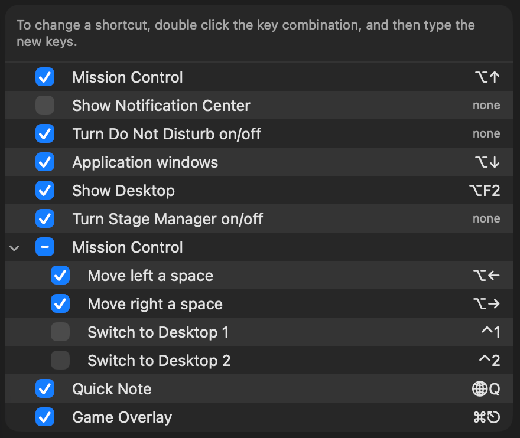
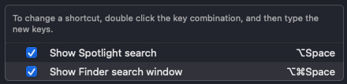
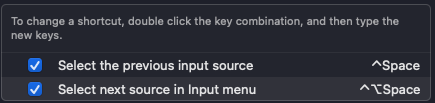
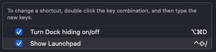
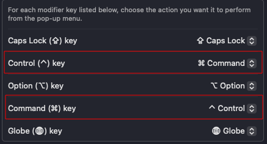
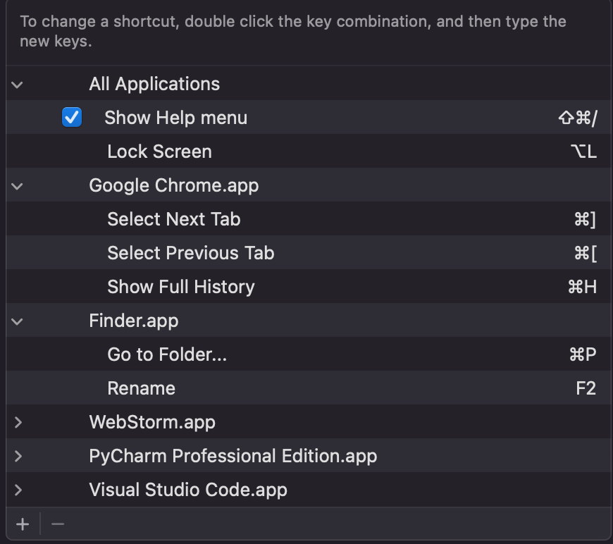
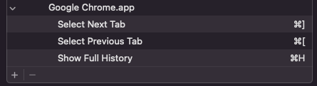
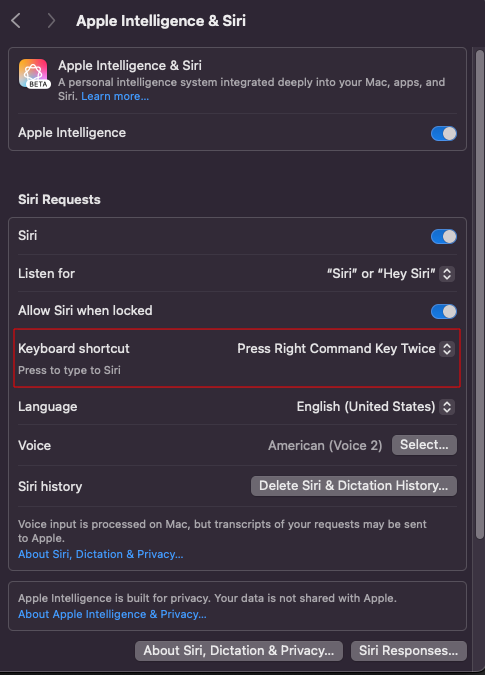
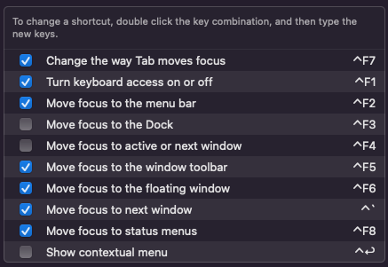
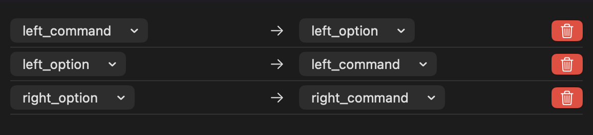

# MacOS Windows-like Keymaps

This project provides a collection of Karabiner-Elements configurations to make your MacOS keyboard behave more like Windows, making the transition between operating systems smoother.

## Required System Shortcut Adjustments

Before using these keymaps, you need to adjust some system shortcuts in macOS System Settings. Here are the necessary changes to ensure compatibility with our Karabiner configurations:

### 1. Mission Control Shortcuts

- Disable or change the default Mission Control shortcuts to avoid conflicts to match with the Karabiner shortcuts
- Uncheck `Move left a space` and `Move right a space` — or rebind them to `Option + ←` / `Option + →`, keeping them consistent with the Mission Control rebind above.

### 2. Spotlight Search

- Update the default Spotlight shortcut from `Command + Space` to `Option + Space` and `Option + Command + Space`.

### 3. Input Sources

- Adjust the keyboard input source switching shortcut to match with the Karabiner shortcuts

### 4. Launchpad and Dock

- Change the default Launchpad shortcut to match with the Karabiner shortcuts

### 5. Keyboard Modifier Keys

- Swap the following modifier keys to match Windows layout:
  - Set the `Control` key to function as `Command`
  - Set the `Command` key to function as `Control`
  This ensures that `Control + C`, `Control + V`, etc. work as expected in Windows style.

### 6. App Shortcuts


- Review and adjust any application-specific shortcuts to match with the Karabiner shortcuts

### 7. Siri Shortcuts

- Change the default Siri shortcut

### 8. Keyboard Shortcuts

- Review and adjust any keyboard shortcuts to match with the Karabiner shortcuts

## Prerequisites

- MacOS (tested on MacOS Ventura and later)
- [Karabiner-Elements](https://karabiner-elements.pqrs.org/) installed on your system

## Installation

1. First, install Karabiner-Elements from the [official website](https://karabiner-elements.pqrs.org/)
2. Open Karabiner-Elements and grant the necessary permissions
3. Navigate to the `~/.config/karabiner/assets/complex_modifications/` directory:
   ```bash
   mkdir -p ~/.config/karabiner/assets/complex_modifications/
   ```
4. Copy the JSON configuration files from this repository's `karabiner` directory to the complex_modifications directory:
   ```bash
   cp karabiner/*.json ~/.config/karabiner/assets/complex_modifications/
   ```
5. Open Karabiner-Elements
6. Go to the "Complex Modifications" tab
7. Click "Add rule"
8. Enable the rules you want to use

## Karabiner Simple Modifications

In addition to the complex modifications, you need to set up the following key swaps in the
Karabiner-Elements "Simple Modifications" tab:



- `left_command` → `left_option`
- `left_option` → `left_command`
- `right_option` → `right_command`

These swaps, together with the [Keyboard Modifier Keys](#5-keyboard-modifier-keys) adjustments,
place `Ctrl`, `Alt` and `Win` in the same physical positions as on a Windows keyboard.

## Available Keymaps

### Windows-like Shortcuts (`windows_shortcuts.json`)

This configuration provides the following Windows-like shortcuts:

- `Home`: Move cursor to beginning of line
- `Shift + Home`: Select to beginning of line
- `Cmd + Home`: Move cursor to top of document
- `Cmd + Shift + Home`: Select to top of document
- `End`: Move cursor to end of line
- `Shift + End`: Select to end of line
- `Cmd + End`: Move cursor to bottom of document
- `Cmd + Shift + End`: Select to bottom of document
- `Ctrl + Left Arrow`: Move cursor one word left
- `Ctrl + Shift + Left Arrow`: Select one word left
- `Ctrl + Right Arrow`: Move cursor one word right
- `Ctrl + Shift + Right Arrow`: Select one word right
- `Ctrl + Backspace`: Delete previous word
- `Ctrl + Delete`: Delete next word
- `Ctrl + Tab`: Next tab (Windows-style)
- `Ctrl + Shift + Tab`: Previous tab
- `Ctrl + F4` (when command_tab_mode is activated): Quit current app (maps to Ctrl + Q)
- `Tap + Left Option` alone: Insert Option + Space (non-breaking space)
- `Ctrl + X`: Cut file (Finder only)
- `Ctrl + V`: Paste / move file after cut (Finder only)

### Chrome-based Keys (`chrome_based_keys.json`)

Additional Chrome-specific shortcuts:
- `F5`: Refresh page

### MacOS Facility Keys (`macos_facility_keys.json`)

This configuration provides additional macOS-specific functionality:
- `F1`: Show/hide Lunchpad
- `F2`: Show/hide Desktop
- `Delete`: Delete file (move to Trash)

## JetBrains IDE Keymap

For JetBrains IDE users (IntelliJ, WebStorm, PyCharm, etc.), we provide a Windows-like keymap configuration. To use it:

1. Download the `jetbrains_keymap_settings.zip` from this repository
2. Open your JetBrains IDE
3. Go to Preferences/Settings > Keymap
4. Click the gear icon and select "Import Keymap"
5. Select the downloaded zip file

## VS Code Icon Tweaks

`vscode/patch_atom_material_icons.sh` reapplies three local changes to the
[Atom Material Icons](https://marketplace.visualstudio.com/items?itemName=AtomMaterial.a-file-icon-vscode)
extension:

- Open folders show the closed-folder icon instead of the theme's empty outline (the original
  icons are kept in `foldersOpen.bak/`).
- `.py` files use the Python icon of the
  [Material Icon Theme](https://github.com/PKief/vscode-material-icon-theme), downloaded from its
  repository, so that extension does not have to be installed.
- File names the VS Code port does not know — `mise.toml`, `ruff.toml` and some 3.4k others —
  get the icon the IntelliJ plugin of the same theme gives them, read from the plugin downloaded
  from the JetBrains Marketplace, so IntelliJ does not have to be installed. An icon the plugin
  draws in near-black, which IntelliJ tints for its dark theme, is copied over in white.
  `.gitmojirc.json`, which neither of them knows, gets the Git icon.
- `.tftpl` files, which neither of them knows either, get the purple Terraform logo of the
  [HashiCorp Terraform](https://marketplace.visualstudio.com/items?itemName=HashiCorp.terraform)
  extension, as IntelliJ shows them through its Terraform plugin.

Run it after every update of the extension, which wipes the changes:

```bash
./vscode/patch_atom_material_icons.sh
```

Then quit VS Code completely (`Cmd + Q`) and reopen it — a window reload keeps serving the cached icons.

## Troubleshooting

If some shortcuts don't work as expected:

1. Make sure Karabiner-Elements is running
2. Check if the rules are enabled in the Complex Modifications tab
3. Try restarting Karabiner-Elements
4. Check the Karabiner-Elements logs for any errors

## Contributing

Feel free to submit issues and enhancement requests!

## License

This project is licensed under the MIT License - see the [LICENSE](LICENSE) file for details.
